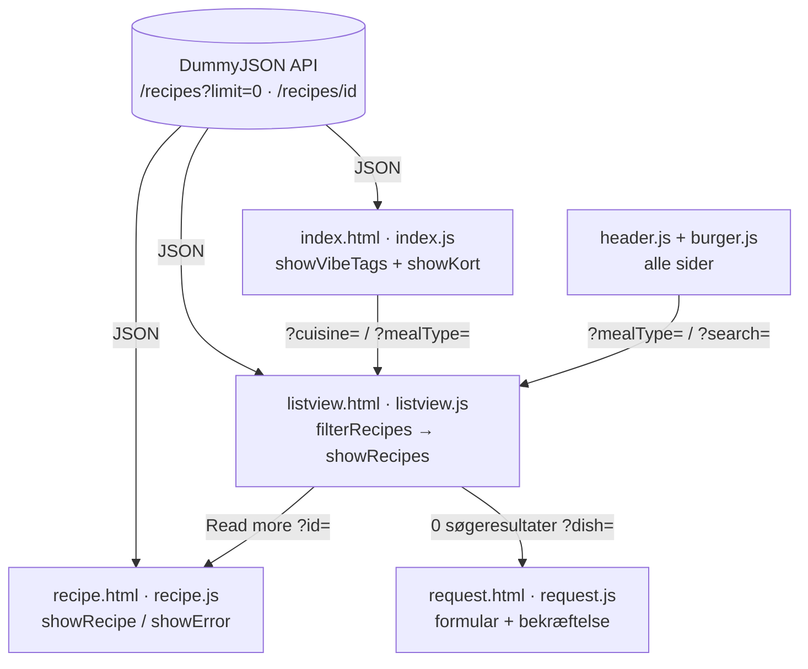

# YUM – Teknisk dokumentation

Tema 8 · Web II · E2026 · Gruppe 9 – Emma Lejel, Lachlan Ryan, Sandra Møller Gregersen

- **Live site:** <!-- TJEK: indsæt GitHub Pages-link -->
- **Repository:** https://github.com/Sandramoellerr/TEMA8-GRUPPE9_RECIPES
- **Data:** [DummyJSON Recipes API](https://dummyjson.com/docs/recipes)

YUM er et dynamisk website med opskrifter til unge, der lige er flyttet hjemmefra. Sitet er bygget i ren HTML, CSS og JavaScript uden frameworks, så koden kører direkte i browseren og kan hostes statisk på GitHub Pages.

----

## 1. Opbygning

```
├── index.html      Forside
├── listview.html   Opskrifter med filtre, søgning og "See more"
├── recipe.html     Én opskrift (single view)
├── request.html    Formular: ønsk en opskrift
├── omos.html       Om os
├── css/
│   ├── generel.css   Fælles variabler, typografi, header, footer, knapper
│   └── index.css · listview.css · recipe.css · request.css
├── javascript/
│   ├── header.js     Bygger måltidsmenuen (alle sider)
│   ├── burger.js     Åbner og lukker mobilmenuen (alle sider)
│   ├── index.js      Forsidens køkken-knapper og måltidskort
│   ├── listview.js   Hentning, filtrering, søgning, paginering
│   ├── recipe.js     Henter og viser én opskrift + rabat-dialog
│   └── request.js    Formular og bekræftelse
└── img/
```

Hver side har sin egen CSS-fil og sit eget script. `generel.css`, `header.js` og `burger.js` deles af alle sider. Alle scripts indlæses med `defer`, så HTML'en er klar, før JavaScript leder efter elementer (som f.eks. media query)

**Navnekonventioner**

| Hvad                       | Konvention                                  | Eksempel                                     |
| -------------------------- | ------------------------------------------- | -------------------------------------------- |
| Filer                      | små bogstaver, sidenavn                     | `listview.js`                                |
| JS-variabler og funktioner | camelCase, funktioner starter med et verbum | `allRecipes`, `filterRecipes()`              |
| HTML-id'er brugt af JS     | camelCase                                   | `#recipeContainer`                           |
| CSS-klasser                | kebab-case                                  | `.recipe-card`                               |
| CSS-variabler              | kebab-case                                  | `--knap-blaa`                                |
| Filterknapper              | `data-filter` + `data-value`                | `data-filter="cuisine" data-value="Italian"` |

Navngivningen blander dansk og engelsk (fx `showKort()`). Det er en kendt inkonsistens, som vi vil ensrette til engelsk i en videre udvikling.

## 2. Dataflow



Siderne deler ingen variabler. I stedet sender de information videre i URL'en, som næste side læser med `URLSearchParams`. Det gør, at filtre kan deles som link, og at tilbage-knappen virker.

Alle sider henter data på samme måde:

```js
fetch(url) // hent fra API'et
  .then((response) => response.json()) // lav svaret om til et JS-objekt
  .then((data) => showData(data)); // byg HTML ud fra data
```

**listview.js** henter alle opskrifter én gang (`?limit=0`, ellers kun 30) og filtrerer lokalt. `filterRecipes()` beholder kun de opskrifter, der passer på både måltid, køkken, tid og søgning. Vi filtrerer i browseren, fordi API'et ikke kan kombinere flere filtre i ét kald. Ved hvert filterklik skriver `history.pushState()` valget i URL'en uden at genindlæse siden.

**recipe.js** læser `id` fra URL'en og henter én opskrift via `/recipes/{id}`. Mangler id, eller svarer API'et med en fejl, viser `showError()` en besked i stedet for en tom side.

**request.js** bruger HTML-validering (`required`, `type="email"`). `preventDefault()` stopper genindlæsning, og formularen byttes ud med en bekræftelse. Der er ingen backend, så ønsket gemmes ikke. Funktionen er en prototype af flowet.

## 3. Databasestruktur (JSON)

`/recipes?limit=0` returnerer et objekt med listen `recipes` og tre tal. `/recipes/{id}` returnerer én opskrift direkte. Forkortet eksempel:

```json
{
  "recipes": [
    {
      "id": 1,
      "name": "Classic Margherita Pizza",
      "ingredients": ["Pizza dough", "Tomato sauce", "..."],
      "instructions": ["Preheat the oven to 475°F (245°C).", "..."],
      "prepTimeMinutes": 20,
      "cookTimeMinutes": 15,
      "servings": 4,
      "difficulty": "Easy",
      "cuisine": "Italian",
      "caloriesPerServing": 300,
      "tags": ["Pizza", "Italian"],
      "image": "https://cdn.dummyjson.com/recipe-images/1.webp",
      "rating": 4.6,
      "mealType": ["Dinner"]
    }
  ],
  "total": 50,
  "skip": 0,
  "limit": 50
}
```

Vi bruger `id`, `name`, `image`, `cuisine`, `mealType`, `prepTimeMinutes`, `cookTimeMinutes`, `difficulty`, `servings`, `ingredients`, `instructions` og `tags`. Tid og sværhedsgrad er valgt, fordi de er målgruppens største barrierer. `rating` og `caloriesPerServing` er fravalgt.

`mealType` og `tags` er arrays, fordi en opskrift kan være både `"Lunch"` og `"Dinner"`. Derfor tjekker koden med `.includes()` i stedet for `===`.

## 4. Kommentarer i koden

Hvert script starter med en kort beskrivelse af sidens flow, efterfulgt af nummererede sektioner (`// 1. API-adressen`, `// 2. Find elementerne i HTML'en` …). Kommentarerne er skrevet på dansk og forklarer både hvad og hvorfor.

## 5. Git og branches

Hvert gruppemedlem arbejder på sin egen branch (`sandra`, `emma`, `Lachlan`) og merger ind i `main`, når en del virker. Vi merger `main` ind i egen branch for at holde os opdateret og løser merge-konflikter manuelt. Næste gang vil vi bruge en branch pr. funktion og pull requests med review, så historikken bliver mere overskuelig.

## 6. Bæredygtighed

- Ingen frameworks eller biblioteker, kun egen HTML, CSS og JavaScript.
- Opskrifterne hentes én gang pr. side, og filtrering sker uden nye kald.
- Listview viser 12 opskrifter ad gangen, så billeder først hentes, når brugeren beder om flere.
- Egne billeder er konverteret til WebP (herobilledet fra 3,3 MB til 0,16 MB).
- Sitet hostes statisk på GitHub Pages, så ingen server kører konstant.

**Forbedringer:** lazy loading på billeder og at undgå et dobbelt API-kald i `listview.js`.

**Brug af AI:** Vi har anvendt AI til strukturering af Teknisk Dokumentation
